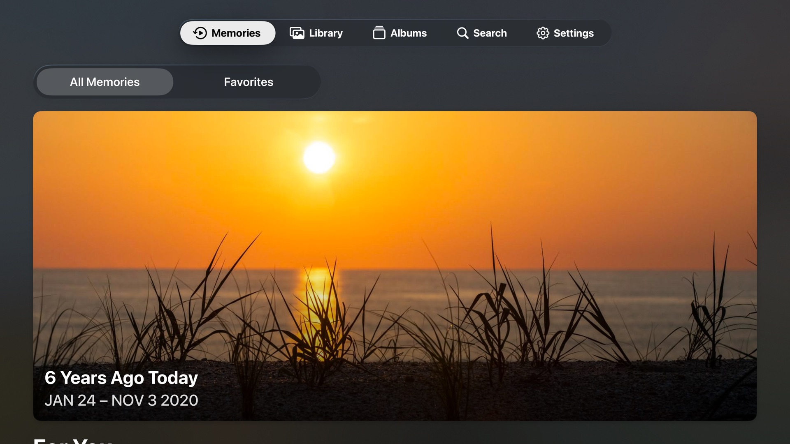
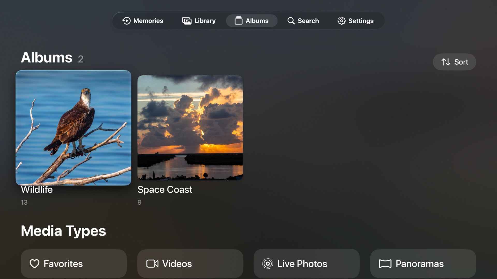
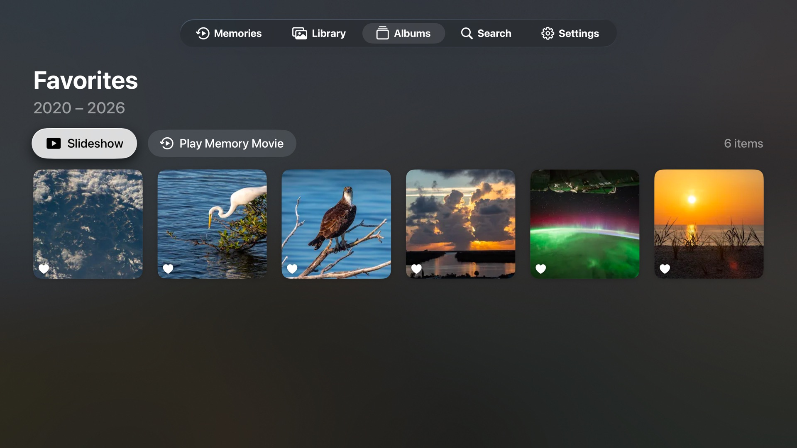
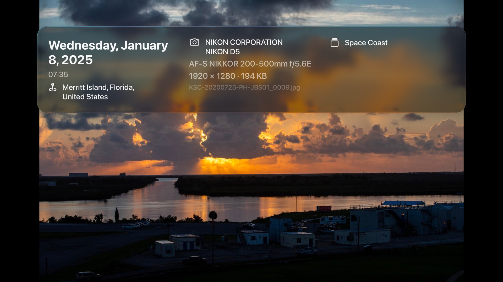
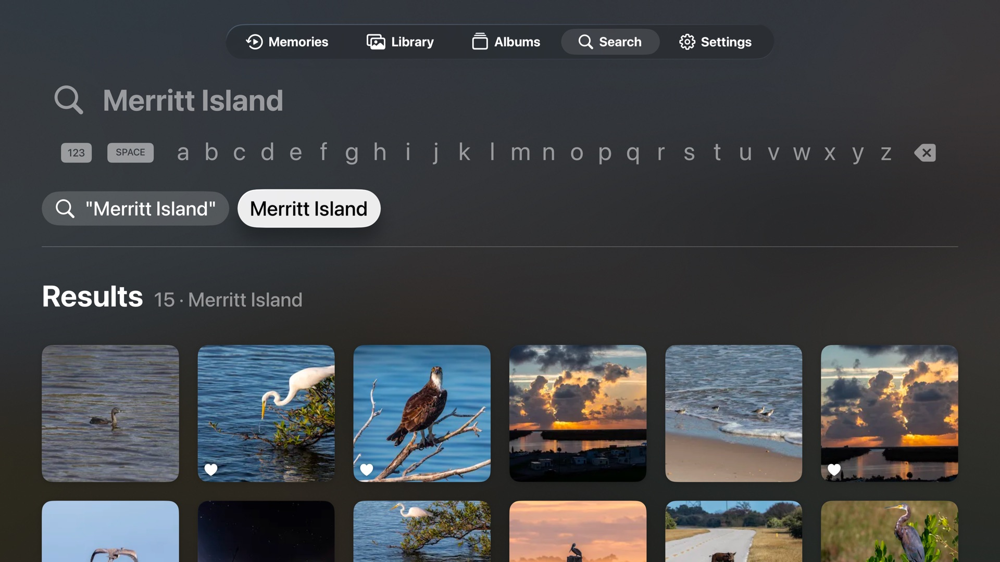
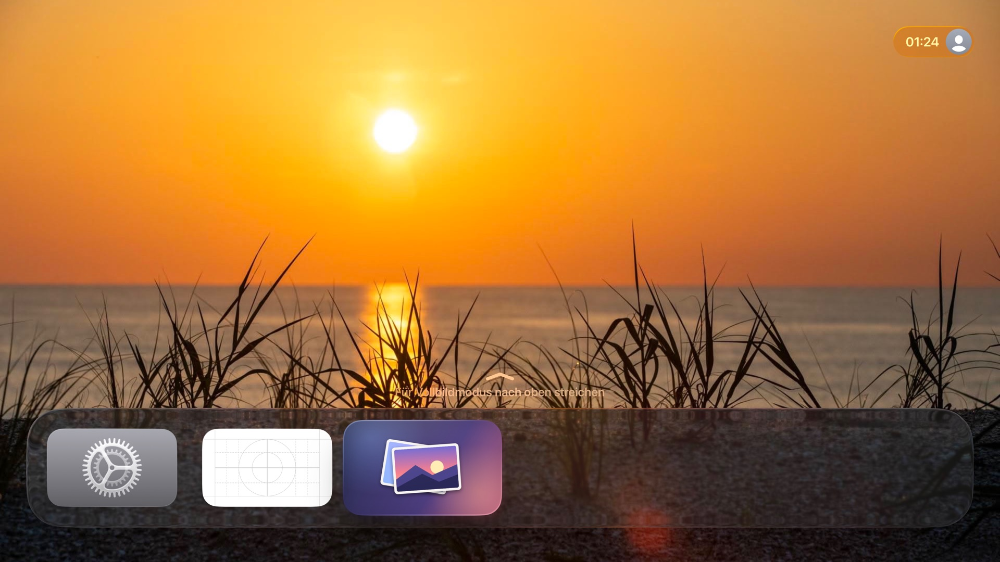
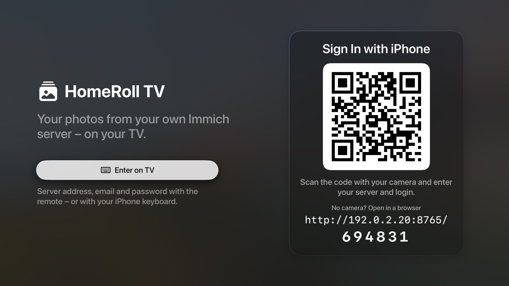

# HomeRoll TV

**A native Apple TV app for your own [Immich](https://immich.app) server – the look and feel of Photos on Apple TV, without iCloud.**

HomeRoll TV is the tvOS sibling of [HomeRoll](https://github.com/silentprovider423/HomeRoll) (iPhone) and HomeRoll Desktop (Mac). It shows the library of a self-hosted Immich server on the big screen: memories with music, the library by years, months and days, albums, people, search, slideshows and a Top Shelf on the Home screen. Everything is built for the Siri Remote – focus, clickpad swipes, Play/Pause, press and hold.

> **Status:** works against Immich v3.3.x in the tvOS 26 simulator (Apple TV 4K), covered by unit tests and remote-control UI tests. UI in **English and German** (follows the Apple TV language). Code comments are in German.
>
> Built with help from [Claude Code](https://claude.com/claude-code): Apple's Photos for tvOS was analysed by names and strings only (no decompiled code), the Swift was written together with it.
>
> **Personal project.** No guarantees, no support promises. Bug reports and pull requests are welcome.
>
> Not affiliated with Apple or with Immich/FUTO. "Immich" is a trademark of its owners.

<p align="center">
  
  
  
  
  
  
  
  
</p>
<p align="center"><sub>Screenshots from the tvOS simulator with a throwaway demo server and public-domain NASA photos (Kennedy Space Center, ISS crew).</sub></p>

## Features

**Memories** (start page)
- On this day (from the server, or built on the device), trips, best of the year, busy months, places over the years
- Full-screen player in 16:9: title card, Ken Burns, two or three portrait photos side by side, video clips, scene changes on the beat
- Self-made background music (four moods, no music files) and six memory mixes (music + colour style)
- Info bar (swipe down): pause, mix, music, sound on/off, favourite, loop; ←/→ jumps between scenes
- "Up Next" with countdown, replay; favourite memories, "Feature this less", delete (hide)

**Library**
- Years · Months · Days · All Photos, chosen with a segmented control (no pinch on a TV); click a year → its months → its days
- Focus grid with lift and parallax (card style), ThumbHash placeholders, favourites filter
- Play/Pause on any tile starts a slideshow from there; press and hold for favourite / slideshow

**Full screen**
- ←/→ next and previous photo, ↓ info (date, place, camera, lens, exposure, size, people, albums), ↑ thumbnail strip
- Live Photos: click plays the motion; videos open in the system player with the tvOS transport bar (±10 s, scrubbing)
- Full-resolution image after the preview, videos the Apple TV can't play fall back to the original or Immich's HLS stream

**Slideshow**
- Themes from Apple's Apple TV templates: **Dissolve** (3 s cross-fade) and **Magazine** (one to three framed photos per page), plus Ken Burns
- Optional music, repeat, shuffle, time per photo; the screen stays on

**Albums, people, search**
- Own and shared albums (sort by name, date modified, custom order), activity (comments, likes) of shared albums
- People & pets, media types (favourites, videos, Live Photos, panoramas)
- "Play Memory Movie" for any album or person
- Search with the on-screen keyboard or dictation: smart search (CLIP on your server) combined with recognised places, people, years, "videos", "favorites"; suggestions for people, places and categories

**Top Shelf**
- When HomeRoll TV sits in the top row of the Home screen, the Top Shelf shows memories and featured photos (carousel or rows), click opens them in the app
- The system loads Top Shelf images itself and doesn't know your server login – so the app saves the previews into the shared App Group folder beforehand

**Sign in without typing on the remote**
- The TV shows a QR code and a six-digit code. Scan it with the iPhone (or open the address in any browser on your network), enter server + email/password or an API key – the TV signs in.
- Or enter everything on the TV with the on-screen keyboard (tvOS also offers the iPhone keyboard).
- API keys work too (Immich › Account Settings › API Keys); for a TV, a key with read permissions is enough.

**View only:** nothing is deleted, edited or uploaded from the TV (only favourites can be set).

## Requirements

- An Immich server (tested with **v3.3.x**) reachable from the Apple TV – at home or via VPN
- An Apple TV that runs **tvOS 26** (tested in the Apple TV 4K simulator)
- Xcode 26 and [XcodeGen](https://github.com/yonaskolb/XcodeGen) (`brew install xcodegen`) to build

## Install without a Mac

Honest answer: **not really possible today.** [SideStore](https://sidestore.io) and [AltStore](https://altstore.io) install apps on iPhone and iPad only – they don't support Apple TV, and the Apple TV has no browser or file manager to open an `.ipa`.

What works:

1. **A Mac with Xcode, once** (yours or a friend's): pair the Apple TV in Xcode (*Settings › Remotes and Devices* on the TV, *Window › Devices and Simulators* in Xcode), then build and run – see below. With a free Apple ID the app runs for 7 days and has to be re-installed from Xcode; with a paid developer account for a year.
2. **TestFlight / App Store** would need someone with a paid Apple developer account to distribute it – there is no public build.

An unsigned `.ipa` for your own signing tools can be built with `./build-ipa.sh` (see below). The server side is explained in **[docs/SETUP.md](docs/SETUP.md)**.

## Build & install

```bash
git clone https://github.com/<you>/homeroll-tv.git
cd homeroll-tv
xcodegen generate
open HomeRollTV.xcodeproj
```

1. Set your own **bundle identifier prefix** and **App Group** in `project.yml` (defaults: `org.homeroll.tv`, `group.org.homeroll.tv`) and select your team in Xcode for both targets (app + Top Shelf extension).
2. Run on your Apple TV. Sign in via QR code or on the TV.
3. Unsigned IPA (for your own re-signing): `./build-ipa.sh` → `build-ipa/HomeRollTV.ipa`.

If your server uses a certificate from your own home CA, put the CA certificate as `Resources/HeimnetzCA.der` into the project – the app then trusts it in addition to the system CAs.

### Tests

```bash
./tools/test.sh          # unit tests of the shared logic on the Mac (API client, memories, slideshow, pairing, Top Shelf)
```

The shared code lives in a Swift package (`Core/`) that also builds for macOS, so the tests don't need a tvOS simulator. With a gitignored `.test-account` file that exports `FOTOS_SERVER` and `FOTOS_TOKEN_FILE`, the live tests run against a real (test) Immich account, read-only.

Remote-control UI tests (`XCUIRemote`) in the tvOS simulator:

```bash
xcrun simctl create "HomeRoll TV Test" com.apple.CoreSimulator.SimDeviceType.Apple-TV-4K-3rd-generation-4K \
  com.apple.CoreSimulator.SimRuntime.tvOS-26-2 > .sim-udid
TEST_RUNNER_FOTOS_SERVER=http://<server>:2283 TEST_RUNNER_FOTOS_TOKEN=<token> \
  xcodebuild -project HomeRollTV.xcodeproj -scheme HomeRollTV -destination "id=$(cat .sim-udid)" test
```

Run the app signed in without typing (debug builds only): `FOTOS_SERVER=http://<server>:2283 FOTOS_TOKEN_FILE=~/.homeroll-token ./sim-run.sh`. Debug builds also read `FOTOS_OPEN=homeroll-tv://asset/<id>` (open a target after loading) and `FOTOS_LOGIN_SCREEN=1`.

## Privacy

- The app talks **only** to your Immich server. No analytics, no third-party SDKs.
- Login (session token or API key) is stored in the Keychain. tvOS apps have no permanent local storage; the timeline and previews are only cached and may be removed by the system at any time.
- The pairing page runs on the TV only while the sign-in screen is open, only in your home network, and only accepts the six-digit code shown on the TV (new code after 5 wrong tries). It is plain HTTP inside your network – if that worries you, use an API key with read permissions instead of your password.
- The Top Shelf extension never contacts the server; it only reads previews the app saved.

## Project layout

```
App/          SwiftUI app for tvOS (Library, Viewer, Memories, Slideshow, Albums, Search, Login, Settings)
TopShelf/     Top Shelf extension (TVTopShelfContentProvider)
Core/         Swift package with the shared logic (API client, models, memories, slideshow, pairing, Top Shelf feed) + tests
UITests/      remote-control UI tests (XCUIRemote)
tools/        icon generator, string catalog, test runner
```

## License

[MIT](LICENSE). Third-party: Immich (AGPL-3.0) is not included – HomeRoll TV only talks to its HTTP API. ThumbHash decoding follows Evan Wallace's ThumbHash (MIT).

---

## Deutsch

**HomeRoll TV** zeigt die Mediathek deines eigenen Immich-Servers auf dem Apple TV – so, wie Apples Fotos-App auf dem Fernseher aussieht und sich mit der Siri Remote bedienen lässt: Rückblicke mit Musik, Mediathek nach Jahren/Monaten/Tagen, Alben, Personen, Suche, Diashow und Top Shelf. Anmelden geht per QR-Code mit dem iPhone. Die Oberfläche gibt es auf Deutsch und Englisch, je nach Sprache des Apple TV.
